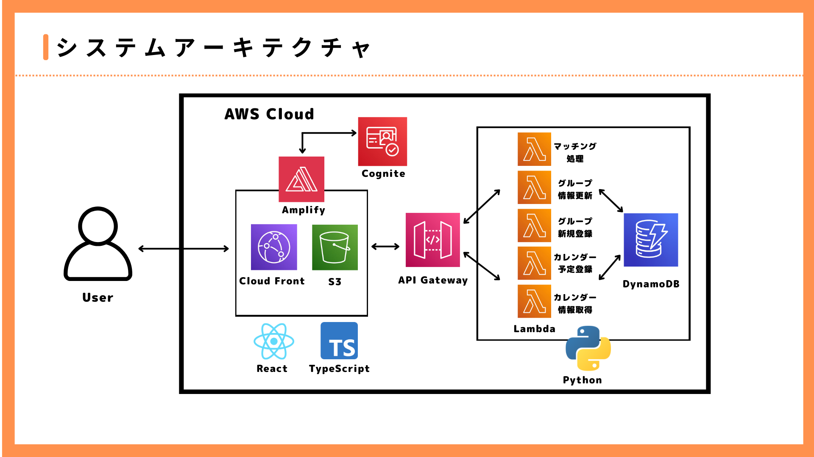

# Event Matching

希望日と趣味を登録すると、同趣味の参加者と会場を自動で組み合わせるマッチングアプリです。

地図・起動・確認手順は本書。境界・依存・I/O・認証・test配置は `DESIGN.md`。

## 概要

ユーザーはカレンダー上で「いつ・何をしたいか」を選ぶ。同じ趣味の人が集まり、必要人数と会場まで提案する。

## 主な機能

1. 希望する日と趣味を登録できる
2. 同じ趣味の人と自動でグループになる
3. 募集の進み具合を確認できる
4. 集まったグループに会場を提案する

## システム構成図

## 技術stack

| 役割 | 選定 |
|------|------|
| UI | React 19 + TypeScript + Tailwind CSS |
| 画面遷移 | React Router v7 |
| サーバ状態 | TanStack Query |
| 認証・Hosting | AWS Amplify Auth（Cognito） / Amplify Hosting |
| API | API Gateway + Lambda（Python） |
| データ | DynamoDB |
| 静的配信 | S3 + CloudFront |

## setup

必要: Node.js、npm

1. `git clone https://github.com/shim1103/event-matching.git`
2. `cd event-matching`
3. `npm install`
4. `npm start`

存在する script は `start` / `build` / `test` のみ。

## 確認方法

1. `npm start` で認証画面が開く
2. ログイン後に `/dashboard` `/register` `/recruiting` `/proposal` を辿る
3. `npm test` は CRA 初期の `App` render 確認のみ

## 設計

層・依存・外部 I/O・認証・test 配置は `DESIGN.md`。

## 開発背景

4日間のハッカソンで作成した prototype。公式イベント名と公開デプロイ URL はここに置かない。
